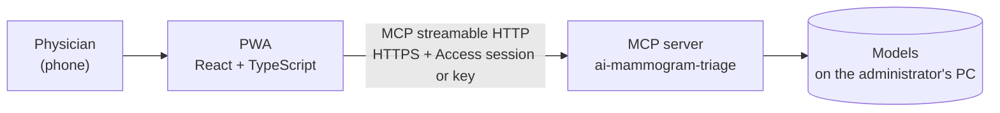
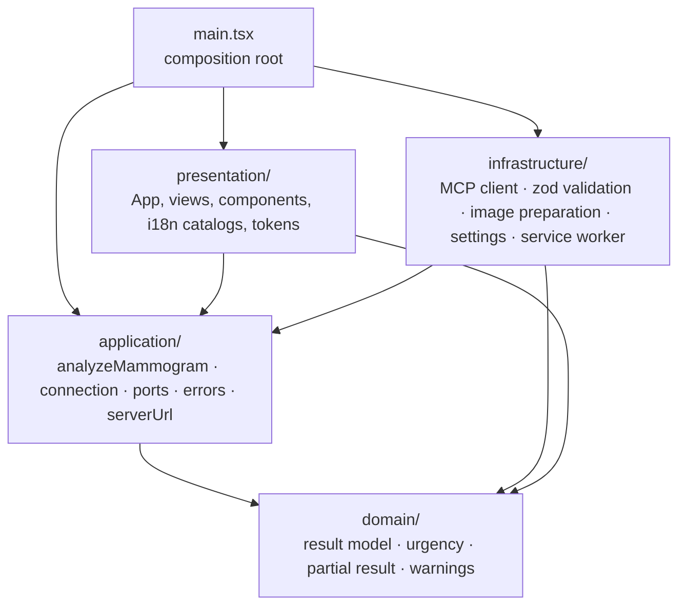
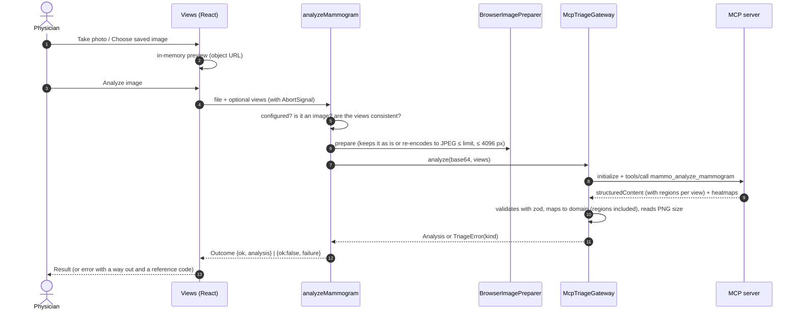
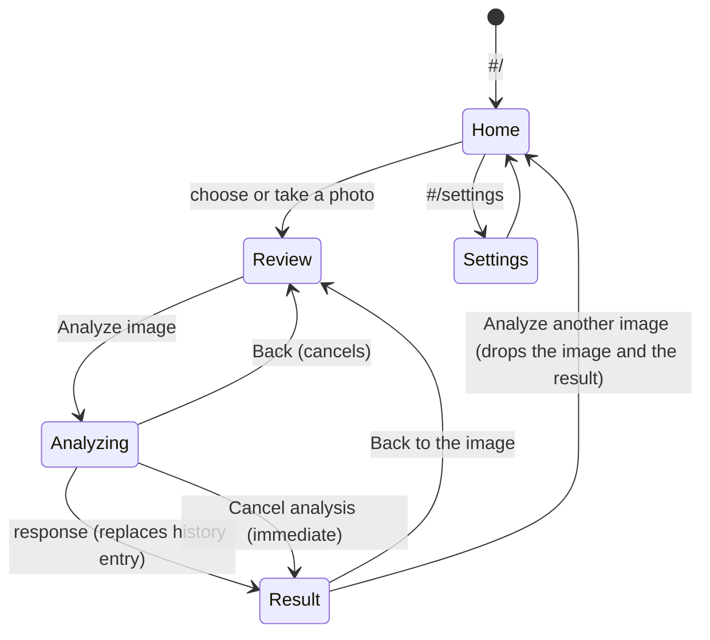

# App architecture

This document explains how the PWA is built: its layers, the path of an analysis, navigation between views, languages
and the service worker.

## 1. Place in the system

The PWA does not analyze anything itself: it prepares the photo and calls the MCP server
[`ai-mammogram-triage`](https://github.com/avalderrama/ai-mammogram-triage), which does all the analysis.

## 2. Layers (onion architecture)

| Layer | Responsibility | Must not import |
|---|---|---|
| `domain` | Result types (`Analysis`, `BreastResult`, `ViewResult`, `SuspiciousRegion`) and pure rules: ordering by urgency, whether the result is partial, study quality warnings | React, MCP SDK, zod, other layers |
| `application` | Use cases: `createAnalyzeMammogram` (validates, prepares, calls and translates errors into a `Failure`) and `createConnectionSettings`. Ports: `TriageGateway`, `ImagePreparer`, `SettingsRepository`. Safe-URL rule | React, SDK, zod, infrastructure, presentation |
| `infrastructure` | `McpTriageGateway` (SDK `@modelcontextprotocol/client` v2), loaded on the first request by `LazyTriageGateway`; `resultMapping` (zod ↔ domain), `BrowserImagePreparer`, `BrowserSettingsRepository`, service worker registration | React, presentation |
| `presentation` | React components, hash routes, UI text in English and Spanish (`i18n/`) and token-based styles | SDK, zod, infrastructure |
| `main.tsx` | Creates the implementations, injects them into the app and wraps it in `I18nProvider` | — |

ESLint (`no-restricted-imports` per folder, in `eslint.config.js`) enforces these rules.

### Presentation components

| Component | File | What it does |
|---|---|---|
| `ImagePicker` | `components/ImagePicker.tsx` | Camera and gallery pickers. Variant `tiles` (default): two large tiles with a hint, used on Home and in the empty Review state. Variant `compact`: two secondary buttons, used to change the image in Review |
| `Probabilities` | `components/Probabilities.tsx` | One stacked bar with the three BI-RADS groups (decorative, `aria-hidden`) plus a text legend with the percentages |
| `LesionViewer` | `components/LesionViewer.tsx` | The heatmap of a view with numbered boxes on the suspicious regions (1 = strongest), placed in percentages of the image so they stay aligned at any size. A **Show markers** checkbox hides the boxes. Below, a text list ("Area N: depth, vertical part of the breast") repeats each location for screen readers and for anyone who hides the boxes. It shows a note when no region stands out and, without a heatmap, the reason (low resolution or not generated) |
| `LevelBadge`, `Banner`, `FailurePanel`, `Disclaimer` | `components/Feedback.tsx` | Level with icon + text + color, view-wide messages, errors with a way out and the reference code, the indicative-result notice |

## 3. Path of an analysis

Each view of the result carries `regions`: up to three suspicious regions from the server's patch model, strongest
first, each with a box normalized from 0 to 1 to the heatmap image, a `score`, a `depth` (`posterior`, `middle`,
`anterior`) and a `vertical` third (`upper`, `middle`, `lower`). `resultMapping.ts` validates them with zod and
defaults the list to `[]` when an older server does not send it. `LesionViewer` draws them over the heatmap. What
they mean is explained in the server's
[scores-and-levels.md](https://github.com/avalderrama/ai-mammogram-triage/blob/main/docs/scores-and-levels.md).

The "optional views" are the optional fields in **Review image**. The number of views is sent when the user picks
one; the breast side and projection of each view are sent when at least one of them is set. Views of the same breast
are combined only when the user sets the number of views and the breast side of each one; otherwise each view is
evaluated on its own.

## 4. Views and navigation

Routes use `#` so the app works on any static hosting and the **Back** button works.

| Route | View | States it handles |
|---|---|---|
| `#/` | Home | Notice when the connection is not set up |
| `#/review` | Review image | Empty (no image), blocked (not set up or offline, with the reason), ready |
| `#/analyzing` | Analyzing | Real steps with elapsed time; cancel |
| `#/result` | Result | Loading (skeleton), empty, error, partial and with data |
| `#/settings` | Settings | Inline validation, testing, connection OK and error with code |

Any other hash shows a "page not found" view with a link home.

`App.tsx` keeps only the chosen image and the latest result in memory. Cancelling, going Back or choosing another
image abandons the running analysis: its late response is ignored.

## 5. Languages (i18n)

The UI opens in the browser's language (`navigator.languages`: Spanish or English, English for any other language);
the user's choice in the Language selector wins and is remembered in `localStorage`.

| Piece | Role |
|---|---|
| `src/presentation/i18n/messages.ts` | The `Messages` type: the shape of every UI string. `Locale` is `'en' \| 'es'`; the default is `'en'` |
| `src/presentation/i18n/en.ts`, `es.ts` | The two catalogs. Each implements `Messages` fully, so a missing translation is a type error |
| `src/presentation/i18n/I18nProvider.tsx` | Context that exposes `useI18n()` → `{ t, locale, setLocale }`, keeps `<html lang>` in sync and remembers the choice |
| `src/presentation/components/LanguageSwitcher.tsx` | Native `<select>` in the header; each language is named in its own language with a `lang` attribute |

- The choice is stored in `localStorage` under `mammo-triage.locale`. It is not sensitive; if storage is blocked, the
  choice lasts for the session only.
- `index.html` and the manifest declare `lang="en"`. After the app loads, `I18nProvider` updates `<html lang>` to the
  selected language.
- Form errors in Settings are kept as message keys, not text, so they re-render in the new language when the user
  switches.
- `App.test.tsx` checks that the `es` and `en` catalogs have identical keys.

## 6. Errors

Each failure arrives as a `kind` with actionable text (in the i18n catalogs, `failures`), a flag saying whether it can
be retried and a reference code:

| `kind` | Source |
|---|---|
| `not_configured` | The URL is missing, or the remote URL is not HTTPS. The key is optional: behind Cloudflare Access the session identifies the user |
| `not_an_image`, `invalid_input` | Local validation |
| `not_a_mammogram`, `unreadable_image`, `too_large`, `server_busy`, `unexpected` | MCP tool codes |
| `unauthorized` (401), `server_misconfigured` (421/403), `too_large` (413), `rate_limited` (429 with `Retry-After`) | HTTP responses |
| `offline`, `server_unreachable`, `timeout`, `cancelled` | Network, timeout or the user |
| `session_expired` | The request was redirected. The MCP server never redirects, so it is Cloudflare Access asking to sign in again. `McpTriageGateway` uses `redirect: 'manual'` so the redirect is visible instead of an opaque CORS failure |
| `app_outdated` | `LazyTriageGateway` could not download the MCP client chunk while the browser is online. Typically a newer deployment removed the chunk this tab expects. When the browser is offline, the same failure is reported as `offline` |

`FAILURE_FIX` in `messages.ts` says where the user can fix each failure (Settings, the image, retry, or reload); it
does not depend on the language. `app_outdated` and `session_expired` are not retryable: `FailurePanel` replaces the view's buttons with a single
**Reload the page** button. After a failed download the gateway forgets it, so the next request tries again.

## 7. Service worker

`public/sw.js` caches only the app shell (HTML, JS, CSS, manifest and icon) so it opens offline. It never intercepts
the MCP server, whether on another origin or on this one (`/mcp`, `/health` behind Cloudflare Access), nor POST
requests, and it never stores image responses except the icon. The
tests (`serviceWorker.test.ts`) run the real file against a simulated environment.
